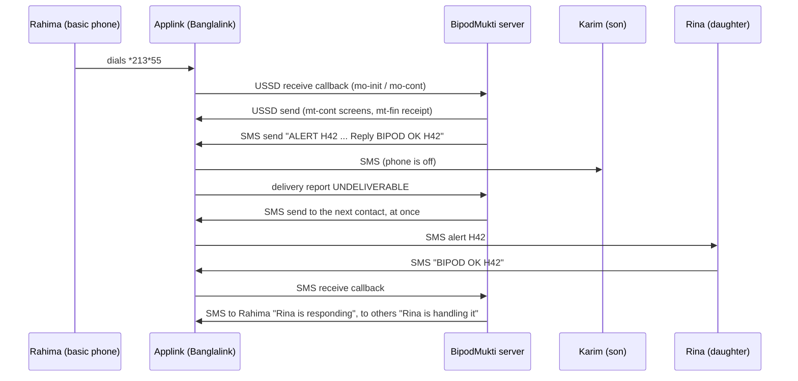

# BipodMukti (বিপদমুক্তি)

**Safety check-ins for basic phones during floods and cyclones in Bangladesh.**
Built for **AppQuest 2.0** by team **Code Karkhana** on **Applink** (SMS, USSD, Subscription and OTP APIs).

When a flood or cyclone hits, mobile data is the first thing to fail and families lose contact. BipodMukti lets a person check in from any basic phone with one USSD dial or one SMS. Their family gets an SMS at once. If someone asks for help and nobody answers, BipodMukti moves to the next family member, then to local volunteers, until a real person replies "I am handling it". After a warning, an NGO or Union Parishad coordinator can run a **roll call** for a whole area and see, live, who has not answered yet.

| | |
|---|---|
| Theme | 2: Human Potential, Health & Society |
| Category | 07: GovTech & Civic Innovation |
| Track | Community & Industry |
| Team | Md. Fazlul Karim (Team Lead), Fahmid Arman |

## How it works



1. **Check in.** USSD menu (`*213*55#`): 1 SAFE, 2 HELP (rescue, medical, food), 3 moving to a shelter, 4 family contacts, 5 settings. One-dial shortcuts: `*213*55*1*1#` = safe at home. Or SMS to the shortcode: `BIPOD SAFE`, `BIPOD HELP rescue near Rajibpur school`.
2. **Family is told.** Up to 3 contacts, in order. A help alert carries a short reference like `H42`; the contact replies `BIPOD OK H42`.
3. **Nobody is forgotten.** No acknowledgement within the timeout (3 min by default), or a failed delivery report, moves the alert to the next contact, then to the area's volunteers, then flags it for the coordinator. Every step is on the incident timeline.
4. **Roll call.** A coordinator asks everyone in an area to check in after a warning. At the deadline, each person who did not answer gets a "missing" alert to their family (`BIPOD SAFE M12` = "I know she is safe", `BIPOD HELP M12` = "send volunteers").

## Applink integration

| Applink API | Calls | Used for |
|---|---|---|
| **USSD** | `POST /ussd/send` (mt-cont, mt-fin) + USSD receive callback | Check-in menu, join, family contacts, leave. Session state keyed on the platform's `sessionId` with a 2-minute TTL. |
| **SMS** | `POST /sms/send` + SMS receive callback + delivery report callback | Alerts, acknowledgements, receipts, roll calls; `BIPOD ...` commands; delivery reports trigger early escalation. |
| **Subscription** | `POST /subscription/send` (action 1/0), `/subscription/query-base`, `/subscription/getSubscriberChargingInfo` + subscriber notification callback | Opt-in with stored consent wording, `BIPOD STOP` opt-out, a local subscription mirror, base size as a health check. |
| **OTP** | `POST /otp/request`, `/otp/verify` | Web sign-up: verify a family member's number and activate the subscription. `referenceNo` never leaves the server. |

Integration rules we follow (all tested):

- Every request value is a JSON string; optional fields are omitted, never sent empty.
- Success is decided from `statusCode`, never from HTTP 200. Codes are mapped to classes (configuration, client, user-state, transient); only transient ones are retried, with backoff.
- Credentials live only in environment variables, read in one module, never logged, never sent to a browser.
- Every callback answers `200 S1000` first and works afterwards, checks `applicationId`, ignores duplicates (`requestId`), and never logs the subscriber notification's password.
- One environment variable per provisioned API. An unset URL means "not enabled", and the client refuses to call it.

### Proof

- `npm run conformance` calls every wrapper against **hSenid's official Applink mock server** (normal, minimal/variant and failure responses): **24 requests, 0 BAD**.
- hSenid's `scripts/test-callbacks.sh` against our callback routes: **16 passed, 0 failed** (including malformed JSON, empty body, wrong applicationId, duplicates).
- `npm test`: 14 tests, including end-to-end flows over real HTTP (USSD help request, failed delivery, acknowledgement, duplicate callbacks, roll call, OTP sign-up, opt-out).

## Run it

Requires Node.js 24 or newer. No build step: Node runs the TypeScript directly.

```bash
npm install
npm run demo        # simulator mode on http://localhost:3000, 45-second escalation timer
```

- `/` overview, `/console` coordinator console, `/simulator` virtual basic phones, `/join` web sign-up with OTP.
- Simulator mode replaces Applink with a built-in simulated network that answers on the same paths with the same request checks, and posts the same callbacks back. All demo names and numbers are invented test data.

Live Applink:

```bash
cp .env.example .env   # fill APPLINK_APP_ID, APPLINK_PASSWORD, the service URLs, keyword, shortcode, USSD code
npm start
```

Register these callback URLs in the Applink portal (replace the host):

| Portal setting | URL |
|---|---|
| SMS receive (MO) URL | `https://<host>/api/applink/sms/receive` |
| SMS delivery report URL | `https://<host>/api/applink/sms/report` |
| USSD receive URL | `https://<host>/api/applink/ussd/receive` |
| Subscription notification URL | `https://<host>/api/applink/subscription/notify` |

Other commands: `npm test`, `npm run typecheck`, `npm run conformance` (needs the Applink mock running on port 8089).

## Project layout

```
src/applink/     Applink client (one post() + a wrapper per API), status codes, tel: addressing
src/domain/      check-ins and escalation, roll calls, SMS commands, USSD menu, subscriptions, outbound SMS queue
src/web/         Applink callback routes, console API + live event stream, web sign-up
src/sim/         simulated Applink network and virtual phones (simulator mode only)
public/          console, simulator and sign-up pages (plain HTML/CSS/JS)
test/            unit and end-to-end tests
scripts/         conformance run against the official Applink mock
```

Storage is SQLite (Node's built-in `node:sqlite`). Escalation timers, roll-call deadlines and SMS retries are rows in the database, so a restart loses nothing.

## Disclosure

- **Built during AppQuest 2.0** (started 22 November 2026). No code, design or assets from before the hackathon.
- **AI tools:** we used Claude (Anthropic) through Claude Code as a coding assistant for code, tests and documentation, and ChatGPT for brainstorming ideas. The team reviewed and tested what it produced.
- **Applink as a Skill** (hSenid Mobile) was used as reference documentation for the API contract, and its mock server and callback test script were run locally to test our integration. None of its files are copied into this repository.
- **Open-source libraries:** Fastify and @fastify/static (MIT), Leaflet (BSD-2-Clause, loaded from cdnjs), OpenStreetMap tiles (© OpenStreetMap contributors).
- Applink, hSenid Mobile and Banglalink are trademarks of their owners and are named here only to describe the integration.

## License

MIT. See [LICENSE](LICENSE).
